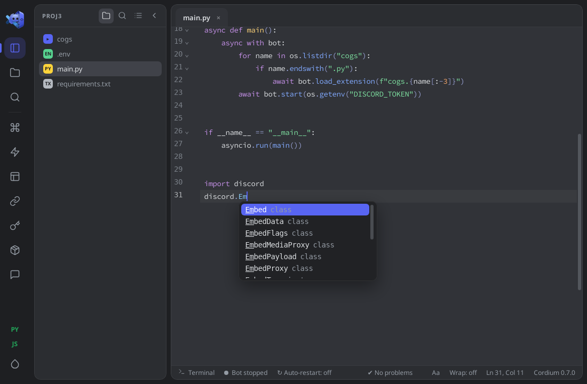
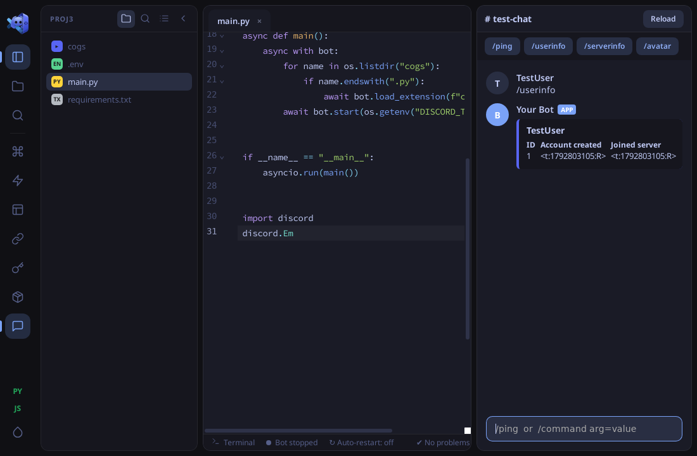
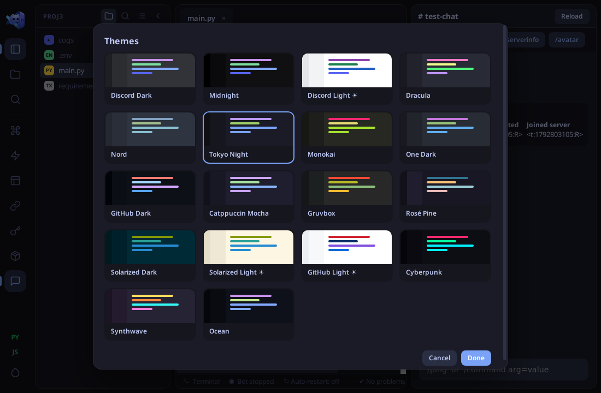

<div align="center">
  
</div>

<div align="center">


# Cordium

### The Purpose-Built IDE for Discord Bot Developers

[](https://github.com/GwenAsa/cordium-ide/releases)
[-5865F2?style=for-the-badge&logo=linux&logoColor=white)](#download--install)
[](https://tauri.app)
[](#code-intelligence)

<p align="center">
  <b>A native, Discord-styled editor with real code intelligence for discord.py and discord.js.</b>
</p>

[Download](#download--install) &bull; [Features](#core-features) &bull; [Screenshots](#screenshots) &bull; [Shortcuts](#shortcuts) &bull; [Build from source](#build-from-source)

---

</div>

##  Overview

**Cordium** is a desktop IDE focused on one job: building, testing and running Discord bots with **discord.py** and **discord.js**.

It uses a Tauri (Rust) shell with the operating system's own web view instead of bundling a browser, so the installer is only **~8 MB**. The UI follows the Discord desktop app (blurple/dark palette, server-style rail, floating panels) and adapts to any window size, so it works well in a half-screen layout next to your browser.

> **About memory:** the shell is light, but code intelligence is real work. Measured on Linux in a virtual display: **~350 MB** idle, **~560 MB** with Python intelligence active and **~630 MB** with JavaScript/TypeScript intelligence active. If RAM is tight, switch on **Light mode** (see [Memory & Light mode](#memory--light-mode)).

---

## Screenshots

<div align="center">
  
  
  <br />
  
</div>

---

##  Core Features

###  Code Intelligence
* **Python:** [Jedi](https://github.com/davidhalter/jedi) analyses your code with the Python standard library stubs, your project's `.venv`, and a **bundled copy of the discord.py source**, so `discord.*`, `commands.*`, `app_commands.*` and everything else complete even before you install anything. Hover shows the real signature and docstring.
* **JavaScript and TypeScript:** the TypeScript language service runs in a Web Worker with bundled **discord.js v14 typings** (including `@discordjs/builders`, `discord-api-types`), Node.js types and the ES2022 library. Completion with signatures, hover, and real type errors in `.ts` files.
* **Discord bot linter with quick fixes:** missing `await` on `interaction.response.send_message(...)`, blocking `time.sleep()` / `requests` in an async bot, reading `message.content` without the Message Content intent. One click applies the fix.
* **Snippets:** built-in (`slash`, `cog`, `listener`, `embed`, `button`, `loop`, ...) plus your own (palette: *My snippets*).
* **Click-through errors:** stack-trace paths in the terminal output (`main.py:42`) open the file at that line. Syntax errors are marked after every save.

###  Test Chat (no Discord, no token)
* Runs your slash commands against a **fake interaction**, for **discord.py** (`cogs/`) and **discord.js** (`commands/`), and shows the reply the way Discord does, including **embeds** (title, description, fields, footer, colour) and ephemeral replies.
* Files with errors are skipped with a clear warning instead of breaking the whole chat.

###  Visual Bot Tools
* **Slash command builder**, **Embed builder** (live preview) and **Components builder** (button / select menu / modal) generate ready-to-paste Python or JavaScript.
* **Ready-made modules:** Moderation (`/kick`, `/ban`, `/timeout`, `/purge`), Server & user info, Welcome messages, added to your project in one click.
* **Invite link and Intents calculator** with permission checkboxes and privileged-intent warnings.
* **`.env` manager:** values of `TOKEN`, `SECRET`, `KEY`, `PASSWORD` variables are hidden in the form, and `.gitignore` is updated to protect `.env`. A **token guard** warns when something that looks like a Discord token is saved in a normal source file.

###  Workspace
* **Hide / show the file explorer** (click, or `Ctrl+B`). Panels resize, and below 760 px the explorer becomes a floating overlay so the code keeps its width.
* **Bot outline** (commands, events, cogs), project-wide **search and replace**, **Git** actions and branch display, **Format document** (black / prettier if installed), word wrap, **Zen mode**, auto-save and an optional **auto-restart on save**.
* Open a project straight from a shell: `cordium .` or `cordium /path/to/bot`.

###  Terminal and Running
* **Real interactive terminal** (PTY) with `pip`, `npm`, `git`, and password prompts, hidden until you click *Terminal* (or press ``Ctrl+` ``). A separate **Output** tab shows your bot's logs, with a dot on the button when something new (or an error) arrives while the panel is closed.
* **Install dependencies** creates a `.venv` for Python projects or runs `npm install`.

---

## Themes and Fonts

<div align="center">
  
</div>

**18 themes** with a visual picker (rail button or palette: *Choose theme*):

| Category | Presets |
| :--- | :--- |
| **Discord** | `Discord Dark`, `Midnight`, `Discord Light` |
| **Developer favourites** | `Dracula`, `Nord`, `Tokyo Night`, `Monokai`, `One Dark`, `GitHub Dark`, `GitHub Light`, `Catppuccin Mocha` |
| **Vibrant and specialised** | `Cyberpunk`, `Synthwave`, `Gruvbox`, `Rosé Pine`, `Solarized Dark`, `Solarized Light`, `Ocean` |

**Fonts** (button `Aa`): code fonts *Source Code Pro* (default), *IBM Plex Mono*, *Fira Code*, *Roboto Mono*, *JetBrains Mono*; interface fonts *Noto Sans* (default), *Nunito Sans*, *Inter*; *Vazirmatn* is used as a fallback for Arabic/Persian text. Code ligatures are **off** by default and can be switched on.

---

##  Download & Install

| Platform | Format | Version | Download |
| :--- | :--- | :--- | :--- |
| **Linux** (Debian, Ubuntu, Zorin OS, ...) | `.deb` | `v0.7.0` | [Releases](https://github.com/GwenAsa/cordium-ide/releases) |

```bash
sudo apt install ./Cordium_0.7.0_amd64.deb
cordium            # or start it from the application menu
```

**Requirements:** `python3` (Python intelligence, Test Chat and running Python bots) and Node.js 20.6+ (to run discord.js bots). Optional: `black` and `prettier` for *Format document*.

---

##  Getting Started

1. **Create a project:** click **PY** or **JS** in the left rail and pick an empty folder. You get a discord.py project (cogs, `/ping`) or a discord.js v14 project (command handler, `/ping`).
2. **Install dependencies:** palette (`Ctrl+Shift+P`) &rarr; *Install dependencies*.
3. **Add your token:** key button in the rail (`.env` manager). Never put the token in source files.
4. **Test without Discord:** open **Test Chat** (chat button in the rail), click a command chip and press Enter.
5. **Run for real:** press **`F5`**. Logs appear in the *Output* tab of the terminal panel.

---

## Memory & Light mode

| State | Approx. RAM |
| :--- | :--- |
| Idle (welcome screen) | ~350 MB, mostly the system web view |
| Python file open (Jedi running) | ~560 MB |
| JavaScript / TypeScript file open (language service running) | ~630 MB |

Measured in a virtual display with software rendering, so use them as a guide. To save memory run palette &rarr; **Toggle smart code intelligence / light mode** and restart Cordium: the heavy engines are not started, and completion falls back to a small built-in list of common discord.py / discord.js names.

---

##  Shortcuts

| Keybinding | Function |
| :--- | :--- |
| `Ctrl+P` / `Ctrl+Shift+P` | Command palette and quick file open |
| `F5` | Run the bot |
| `Ctrl+S` | Save |
| `Ctrl+B` | Show / hide the file explorer |
| ``Ctrl+` `` | Show / hide the terminal |
| `Ctrl+Shift+F` | Search in project |
| `Alt+Shift+F` | Format document |
| `Alt+Z` | Toggle word wrap |
| `Ctrl+Alt+Z` | Zen mode |
| `Ctrl` + `+` / `-` / `0` | Editor font size |
| `F1` | List of shortcuts |

---

##  Build from Source

Requirements: Node.js 20+, Rust stable (1.90 or newer), and on Debian/Ubuntu:

```bash
sudo apt install libwebkit2gtk-4.1-dev build-essential libssl-dev libxdo-dev libayatana-appindicator3-dev librsvg2-dev
```

```bash
npm install
npm run tauri dev                       # run in development
npm run tauri build -- --bundles deb    # produces src-tauri/target/release/bundle/deb/*.deb
```

Project layout:

```
src/                  UI (vanilla JS + CodeMirror 6): editor, panels, builders, Test Chat, themes
src/ts-worker.js      TypeScript language service (Web Worker)
src/intel.js          completion / hover clients (Jedi + TypeScript)
src/modules/          ready-made bot modules (py + js)
src-tauri/src/        Rust shell: files, process runner, PTY, Jedi bridge
src-tauri/resources/  vendored Jedi, Parso and discord.py source
public/types/         bundled discord.js / Node / ES typings
scripts/              refresh-python-intel.sh, refresh-types-bundle.mjs
```

Pushing a tag such as `v0.7.1` runs `.github/workflows/release.yml`, which builds the `.deb` and attaches it to the release.

---

##  Known Limitations

* Linux `.deb` only for now (no Windows / macOS builds, no AppImage yet).
* Test Chat uses a fake interaction: it does not reproduce real permissions, latency, voice, or button / select / modal rendering, and Discord timestamp markup (`<t:...:R>`) is shown as raw text. Always do a final run against a real test server.
* discord.js completion uses the bundled typings (v14.27.0), not the version in your project's `node_modules`.
* The first Python completion after opening a project can take a few seconds while Jedi warms up.
* The window title bar is the system one.

---

##  License

Distributed under the **MIT License**, see [`LICENSE`](./LICENSE). Bundled third-party components and their licenses are listed in [`THIRD_PARTY_NOTICES.md`](./THIRD_PARTY_NOTICES.md). Cordium is an independent project and is not affiliated with Discord Inc.

<div align="center">
  <br />
  <sub>Crafted for the Discord developer community.</sub>
</div>
